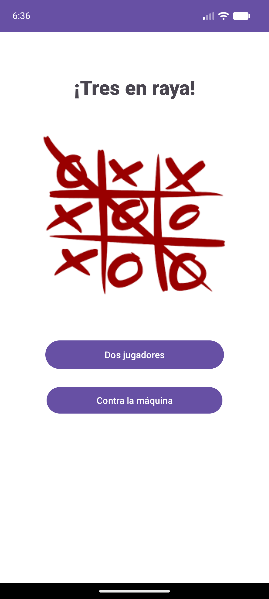
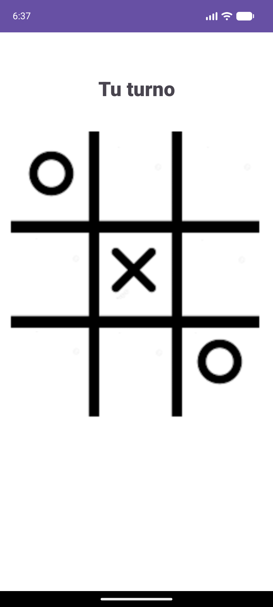
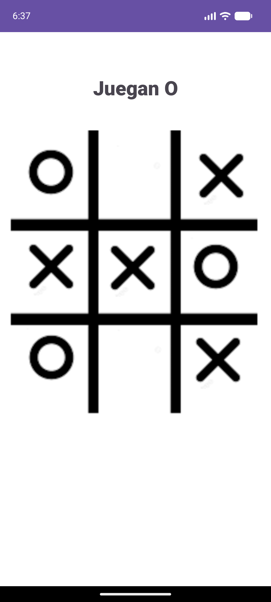

<h1 align="center">Tres en raya</h1>

<p align="center">
  
  
  
  
</p>

**Tres en raya** es una app para Android del juego de siempre, hecha en Java. Tiene dos modos: **dos jugadores**, para jugar con un amigo en el mismo móvil, y **contra la máquina**, una inteligencia artificial que gana cuando puede, tapa tus jugadas, usa trampas clásicas y corta tus dobles amenazas. **No se le puede ganar:** como mucho le sacarás un empate.

<p align="center">
  
  &nbsp;
  
  &nbsp;
  
</p>

---

## Instalación

No hace falta instalar nada más ni tocar código. Solo necesitas un móvil Android.

<p align="center">
  <a href="https://github.com/walteralee/Tres_en_raya_Walter/releases/latest/download/TresEnRaya.apk">
    
  </a>
</p>

<p align="center">
  ¿Estás en el ordenador? Escanea el código con la cámara del móvil:<br /><br />
  
</p>

1. **Descarga** el APK desde el móvil: pulsa el botón verde o escanea el QR.
2. **Ábrelo.** Si Android lo pide, toca **Ajustes** y activa **"Permitir de esta fuente"**.
3. **Pulsa Instalar** y abre **Tres en raya**.

> Funciona en cualquier móvil con Android 7.0 o superior. Ocupa 6 MB, no pide ningún permiso y no necesita internet para jugar.
> Para desinstalarlo, mantén pulsado el icono y elige **Desinstalar**.

---

## Funcionalidades

- **Dos jugadores:** dos personas se turnan en el mismo móvil (O contra X). Quién empieza se sortea en cada partida.
- **Contra la máquina:** juegas con la X y la máquina con la O. En cada turno la máquina:
  1. gana si puede,
  2. tapa tu jugada si vas a ganar,
  3. aplica aperturas y trampas (esquina, centro, triángulo, L corta y L larga),
  4. corta tus dobles amenazas antes de que las hagas.
- Al terminar se muestra el resultado (victoria o empate) y a los 2 segundos empieza otra partida.

## Tecnologías

| | |
|---|---|
| Lenguaje | Java 11 |
| Plataforma | Android (mínimo Android 7.0, API 24) |
| Interfaz | Layouts XML con ConstraintLayout y Material 3 |
| Compilación | Gradle 8.7 con Android Gradle Plugin 8.6 |
| Tests | JUnit 4 |

## Ver o ejecutar el código

Solo si quieres ver o modificar el código. Necesitas [Android Studio](https://developer.android.com/studio), que ya trae todo lo necesario.

1. Descarga el código: botón verde **Code > Download ZIP** de esta página y descomprímelo, o con Git:

   ```bash
   git clone https://github.com/walteralee/Tres_en_raya_Walter.git
   ```

2. En Android Studio: **File > Open** y elige la carpeta `Tres_en_raya_Walter`. Espera a que termine de cargar (la primera vez tarda unos minutos).
3. Pulsa **Run ▶**. Se abrirá en el emulador o en tu móvil si lo conectas por USB.

Desde la terminal también se puede compilar y pasar los tests:

```bash
./gradlew assembleDebug
```

```bash
./gradlew testDebugUnitTest
```

En Windows usa `gradlew.bat` en lugar de `./gradlew`. El APK queda en `app/build/outputs/apk/debug/`.

## Cómo está hecho

```text
app/src/main/java/com/example/tres_en_raya/
├── inicio.java           pantalla de inicio (elegir modo)
├── contra_amigo.java     partida a dos jugadores
├── contra_maquina.java   partida contra la máquina
├── Maquina.java          inteligencia de la máquina
└── Reglas.java           reglas del juego: ganador, empate y tablero
app/src/test/java/...     tests de Reglas y de Maquina
```

El tablero es una matriz 3×3 en la que cada jugador usa un número (1 o 5). Así basta con sumar una línea para saber qué hay en ella: 3 o 15 es tres en raya y 2 o 10 es una amenaza. Los tests juegan **todas las partidas posibles** contra la máquina y comprueban que nunca pierde ni juega en una casilla ocupada.

## Autor

**Walter Alejandro Cutiño Ledo** · [github.com/walteralee](https://github.com/walteralee)

## Licencia

Proyecto de uso educativo y personal.

---

## English

**Tres en raya** is a tic-tac-toe app for Android written in Java. Play against a friend on the same phone, or against an AI that wins when it can, blocks your moves, uses classic traps and stops your forks. It can't be beaten: the best you can get is a draw.

**Install in 3 steps** (Android 7.0+, no permissions needed):

1. Download **[TresEnRaya.apk](https://github.com/walteralee/Tres_en_raya_Walter/releases/latest/download/TresEnRaya.apk)** on your phone, or scan the QR code above.
2. Open it. If Android asks, allow installs from this source.
3. Tap **Install** and open **Tres en raya**.

**Run from source:** open the project in Android Studio and press Run, or use `./gradlew assembleDebug`.
**Tech:** Java 11, Android (API 24+), Gradle, JUnit 4.
**Author:** Walter Alejandro Cutiño Ledo · [github.com/walteralee](https://github.com/walteralee)
